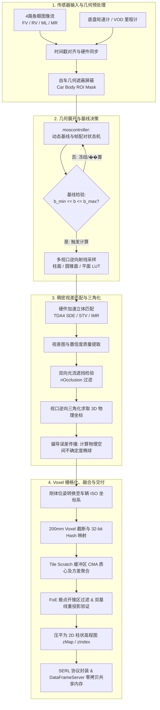

# NFOCC TECHNICAL ARCHITECTURE REPORT

> **核心算法**：运动双目 (MOS / SfM) / 多视口射线采样 / 双基线几何验证 / 3D Voxel 栅格化  
> **计算平台**：ARM NEON / Vulkan / OpenCL  

---

## 目录
- [NFOCC TECHNICAL ARCHITECTURE REPORT](#nfocc-technical-architecture-report)
  - [目录](#目录)
  - [1. 系统概述与端到端 Pipeline 全景架构](#1-系统概述与端到端-pipeline-全景架构)
    - [1.1 系统背景与设计目标](#11-系统背景与设计目标)
    - [1.2 端到端 Pipeline 流水线分解](#12-端到端-pipeline-流水线分解)
    - [1.3 系统端到端架构流程图](#13-系统端到端架构流程图)
  - [2. 运动双目（MOS）几何原理与多视口射线投影模型](#2-运动双目mos几何原理与多视口射线投影模型)
    - [2.1 运动基线解算与帧配对状态机](#21-运动基线解算与帧配对状态机)
    - [2.2 超广角鱼眼的多视口展开与逆向光线采样](#22-超广角鱼眼的多视口展开与逆向光线采样)
  - [3. 3D 稠密三角化反投影与空间误差传播模型](#3-3d-稠密三角化反投影与空间误差传播模型)
    - [3.1 柱面视口三角化几何数学推导](#31-柱面视口三角化几何数学推导)
    - [3.2 物理空间不确定度模型（Spatial Uncertainty）](#32-物理空间不确定度模型spatial-uncertainty)
  - [4. Voxel 空间尺寸限制、离散化与 CMA 聚合](#4-voxel-空间尺寸限制离散化与-cma-聚合)
    - [4.1 体素网格尺寸与 ROI 包围盒约束](#41-体素网格尺寸与-roi-包围盒约束)
    - [4.2 空间坐标离散化与 32-bit 紧凑 Hash ID](#42-空间坐标离散化与-32-bit-紧凑-hash-id)
    - [4.3 累积移动平均（Cumulative Moving Average, CMA）](#43-累积移动平均cumulative-moving-average-cma)
  - [5. 全流程射线遮挡计算与伪影抑制算法](#5-全流程射线遮挡计算与伪影抑制算法)
    - [5.1 防御 1：自车物理多边形掩码（Car Body ROI Masking）](#51-防御-1自车物理多边形掩码car-body-roi-masking)
    - [5.2 防御 2：双向光流一致性遮挡检测（Forward-Backward Occlusion Check）](#52-防御-2双向光流一致性遮挡检测forward-backward-occlusion-check)
    - [5.3 防御 3：运动极点发散锥过滤（Focus of Expansion, FoE Unsure Cone）](#53-防御-3运动极点发散锥过滤focus-of-expansion-foe-unsure-cone)
    - [5.4 终极防御：双基线体素重投影交叉验证（Double Baseline Voxel Verification）](#54-终极防御双基线体素重投影交叉验证double-baseline-voxel-verification)
  - [6. 多相机汇聚、高程图压缩与下游系统交付](#6-多相机汇聚高程图压缩与下游系统交付)
    - [6.1 2D 高程图位图与 Z-Index 垂直连续柱状压缩](#61-2d-高程图位图与-z-index-垂直连续柱状压缩)
    - [6.2 下游核心接口结构体与通信流](#62-下游核心接口结构体与通信流)
    - [6.3 跨进程零拷贝传输（DataFrameServer 中间件）](#63-跨进程零拷贝传输dataframeserver-中间件)
  - [7. 工程源码与核心函数对照全景矩阵](#7-工程源码与核心函数对照全景矩阵)
  - [8. 总结与工程启发](#8-总结与工程启发)

---

## 1. 系统概述与端到端 Pipeline 全景架构

### 1.1 系统背景与设计目标
近场通用视觉感知系统（**NFOCC**）是专为自主泊车（APA）、循迹倒车与低速自动机动系统（LSMS）设计的核心环视视觉感知算法。针对近场超声波雷达感知高度受限、激光雷达成本高昂的问题，系统利用车身四周标配的 4 路鱼眼相机（前视 FV、后视 RV、左视 ML、右视 MR），结合高频轮速计与视觉里程计（**VOD**）估算的自车六自由度运动位姿，利用**运动双目**（Motion Stereo, 简称 **MOS** / SfM）原理重建车身全向 360° 近场密集 3D 几何环境，并将其空间离散化为 **3D 体素（Voxel）点云与 2D 高程柱状图**。

### 1.2 端到端 Pipeline 流水线分解
整个算法流水线（Pipeline）由以下六个关键阶段紧密串联组成：
1. **传感器输入与同步**：获取 4 路同步原始灰度/YUV 鱼眼图像流与高频轮速计/IMU 位姿，加载车身外参几何屏蔽掩码（Car Body ROI Mask）。
2. **动态基线与多视口映射**：状态机基于位移与转角挑选最佳时间基线与辅助基线；基于射线投影模型构建柱面/圆锥面/平面极线查找表（LUT）。
3. **稠密立体匹配与遮挡检测**：在硬件加速器（STV/SDE/IMR）上运行视差搜索，结合双向光流一致性检测过滤运动遮挡断裂带。
4. **3D 三角化与空间误差传播**：由视差与几何参数反求 3D 物理空间坐标，计算关于视差与基线的偏导方差，生成物理空间不确定度椭球。
5. **空间网格体素化与累积聚合**：在车辆坐标系 200 mm 网格中离散化，利用 Tile Scratch 空间哈希建立 32 位 Hash，执行多点累积移动平均（CMA）质心融合。
6. **射线遮挡防御与下游交付**：实施车身掩码、极点发散区（FoE）过滤与双基线重投影验证；汇总多相机体素为 2D 高程图连续柱状结构，经由 SERL 与 DataFrameServer 共享内存无拷贝推流。

### 1.3 系统端到端架构流程图



---

## 2. 运动双目（MOS）几何原理与多视口射线投影模型

### 2.1 运动基线解算与帧配对状态机
单目或单向鱼眼相机在单一静态瞬间缺乏立体基线。系统依靠车辆行进位移形成等效的运动基线（Motion Baseline）：

$$\Delta T = T_{\text{curr}} \cdot T_{\text{prev}}^{-1} = \begin{bmatrix} R & t \\ 0 & 1 \end{bmatrix}, \quad b_{\text{mm}} = \|t\|_2$$

在 `moscontroller.cpp` 的 `Controller::calculateBaseline()` 中，状态机根据实时车速和角速度控制帧配对：
- **最小基线阈值（$b_{\min} \approx 50\text{ mm}$）**：若车速极慢或停止，基线过短导致三角化深度方差爆炸，状态机暂停生成体素；
- **最大基线限制（$b_{\max}$）**：当车辆高速行驶或急转弯时，基线过长会导致两帧图像重叠视场过小，引起视差搜索严重失配；
- **双基线机制（Double Baseline, DB）**：同时维护两组帧对（主基线 $C_0 \to C_1$ 与长/短辅助基线 $C_0 \to C_2$），供后续交叉几何重投影验证。

### 2.2 超广角鱼眼的多视口展开与逆向光线采样
鱼眼相机具有超过 180° 的视场角和显著的径向桶形畸变。为了保证极线搜索严格沿一维水平扫描线进行，NFOCC 在模块 `rencylindricalrenderer.cpp` 和 `renconicalrenderer.cpp` 中实现了柱面、圆锥面与平面投影模型。

算法从展开视口栅格点出发，反向构建空间射线向量 $\mathbf{r}(\theta, \phi)$，并将其投影到鱼眼曲面像素坐标 $(u_f, v_f)$，将映射系数固化在 Look-Up Table（LUT）中：

```cpp
// rensphericalrenderer.cpp: 射线逆投影计算
mat::Vec3f ray;
mat::rotateAboutAxis(ray, backDir, upDir, polarAngle_rad);
computeLutCoords(x, y, ray); // 计算出鱼眼像素坐标并保存至 LUT
```

---

## 3. 3D 稠密三角化反投影与空间误差传播模型

### 3.1 柱面视口三角化几何数学推导
以柱面展开视口（Cylindrical Viewport）为例，在 `mosvoxelisation.cpp` 的函数 `fillVoxelsCylindricalCell()` 中，输入立体匹配视差 $\text{disp}$，方位角 $\theta$ 与轴向位置 $n_{\text{px}}$：

$$\text{ratio} = \frac{b_{\text{mm}}}{\text{disp}}, \quad Z_{\text{view}} = n_{\text{px}} \cdot \text{ratio} + \text{offset}, \quad R_{\text{cyl}} = f_{\text{px}} \cdot \text{ratio}$$
$$X_{\text{view}} = R_{\text{cyl}} \cdot \cos(\theta), \quad Y_{\text{view}} = R_{\text{cyl}} \cdot \sin(\theta)$$

### 3.2 物理空间不确定度模型（Spatial Uncertainty）
在近场感知中，单纯输出 3D 坐标无法满足下游安全避障和概率建图的要求。NFOCC 在体素化阶段即对每个三角化点推导了严格的方差传播。  
对距离函数关于视差 $\text{disp}$ 与基线 $b_{\text{mm}}$ 求偏导：

$$\frac{\partial R}{\partial \text{disp}} = -\frac{f_{\text{px}} \cdot b_{\text{mm}}}{\text{disp}^2} = -\text{ratio} \cdot \left(\frac{1}{\text{disp}}\right), \quad \frac{\partial R}{\partial b} = \frac{f_{\text{px}}}{\text{disp}}$$

综合考虑图像像素级匹配误差 $\sigma_{\text{pixel}}$（由纹理置信度决定）与里程计基线不确定度 $\sigma_{\text{odom}}$，合成 3D 物理空间不确定度（单位：mm）：

$$\sigma_{\text{spatial}} = \max(|f_{\text{px}}|, |n_{\text{px}}|) \cdot \left( \sigma_{\text{pixel}} \cdot \left|\frac{\text{ratio}}{\text{disp}}\right| + \sigma_{\text{odom}} \cdot \frac{1}{\text{disp}} \right)$$

最后通过刚体外参变换将点及不确定度投射至车辆 ISO 坐标系：

$$P_{\text{veh}} = R_{\text{cam}\to\text{veh}} \cdot P_{\text{view}} + t_{\text{cam}\to\text{veh}}$$

---

## 4. Voxel 空间尺寸限制、离散化与 CMA 聚合

### 4.1 体素网格尺寸与 ROI 包围盒约束
为了控制计算资源并保证近场避障精度，算法在自车坐标系下划分固定尺寸的 3D 体素网格。关键配置参数定义在结构体 `MOS_VoxelGridSizes` 中：

| 配置字段 | 工程物理含义 | 典型标定范围 | 代码实现说明 |
| :--- | :--- | :--- | :--- |
| `mmPerVoxel` | 体素立方体单边长度 | **200 mm** | 每个 Voxel 代表 $0.2 \times 0.2 \times 0.2\text{ m}^3$ 的三维物理空间 |
| `mmPerVoxelInv` | 分辨率倒数 ($1 / \text{mmPerVoxel}$) | 0.005 | 在 GPU/DSP/CPU 上用乘法替代除法以提升运算吞吐 |
| `[Xmin_mm, Xmax_mm]` | 纵向感知范围 (车辆前后) | `[-5000 mm, +10000 mm]` | 覆盖车头前向 10 m 及车尾后方 5 m 停车位区域 |
| `[Ymin_mm, Ymax_mm]` | 横向感知范围 (车辆左右) | `[-6000 mm, +6000 mm]` | 覆盖左右两侧各 6 m 的环视近场避障盲区 |
| `[Zmin_mm, Zmax_mm]` | 高度感知范围 (高程地面) | `[-1000 mm, +2500 mm]` | 垂直方向覆盖从地面凹陷至车顶上方的立体空间 |
| `Length_vx, Width_vx, Height_vx` | 网格离散维度上限 | $\le 255 \times 255 \times 31$ | 满足 8 位整数压缩，适配嵌入式高速缓存空间 |

### 4.2 空间坐标离散化与 32-bit 紧凑 Hash ID
在 `mosvoxelisation.cpp` 的 `addVoxel()` 中，系统将连续物理坐标截断并映射为整数网格索引：

```cpp
// 计算三维网格索引 (原点位于 Xmax, Ymax, Zmin)
int32_t xGridCoor_px = static_cast<int32_t>((voxelGridXmax_mm - l_x_mm) * mmPerVoxelInv);
int32_t yGridCoor_px = static_cast<int32_t>((voxelGridYmax_mm - l_y_mm) * mmPerVoxelInv);
int32_t zGridCoor_px = static_cast<int32_t>((l_z_mm - voxelGridZmin_mm) * mmPerVoxelInv);

// 压缩为 32 位紧凑 Hash ID
uint32_t hashId = (u32_(xGridCoor_px) << 16U) | (u32_(yGridCoor_px) << 8U) | u32_(zGridCoor_px);
```

### 4.3 累积移动平均（Cumulative Moving Average, CMA）
当同一帧中多条光线或前后多个时间帧的测量点落在同一个体素内时，系统并不简单地覆盖，而是在 `storeVoxel()` 中执行加权融合：
- **质心迭代**：保留几何不确定度更小、匹配置信度���高的测量点，平滑更新物理坐标 $(x, y, z)$；
- **反射密度累计**：递增计数器 `sourceNumRaw`（低 12 位记录累积原始点数，高 4 位记录来源相机掩码），高点数表征高置信度的物理反射表面。

---

## 5. 全流程射线遮挡计算与伪影抑制算法

视觉立体感知中，遮挡、动态模糊和基线退化极易产生伪 3D 点云。NFOCC 构建了从像素光流、空间视锥到多基线重投影的**三重遮挡防御体系**。

### 5.1 防御 1：自车物理多边形掩码（Car Body ROI Masking）
车身钣金和外后视镜常年处于鱼眼相机视野内。在模块 `nfocc_car_body_roi_array.h` 中，系统标定了各车型的自车遮挡多边形。在 LUT 采样构建阶段，凡是穿过车身自体区域的光线一律被标记为不可见，从源头上杜绝了车身自反射造成的虚假静态体素。

### 5.2 防御 2：双向光流一致性遮挡检测（Forward-Backward Occlusion Check）
车辆前进时，前景障碍物会遮挡远方背景（Occlusion），或者暴露新视场（Dis-occlusion）。在模块 `dof.cpp` 和立体匹配器中，配置参数 `nOcclusion`（默认权值 14）：

$$| d_{\text{fwd}}(x) + d_{\text{bwd}}(x + d_{\text{fwd}}(x)) | > \text{Threshold} \implies \text{标记为遮挡 (Occluded)}$$

检测到视差断裂���时，系统大幅压低该像素的置信度权重，阻止其参与体素化。

### 5.3 防御 3：运动极点发散锥过滤（Focus of Expansion, FoE Unsure Cone）
当车辆直线移动时，运动方向向量所在极点（FoE）周围的光流视差趋近于 0（视线与位移向量 $t$ 平行）。该区域在数学上存在除以 0 的奇异性，导致三角化深度完全失效。  
在 `mostypes_c.h` 中定义开锥体结构 `MOS_FOEUnsureCone`：

```cpp
// 判断体素点 P 是否落在极点发散锥区内
static MOS_FORCEINLINE bool MOS_ptInFoe(const FLOAT X, const FLOAT Y, const FLOAT Z, const MOS_VoxelArray_t* vox) {
    for (uint32_t i = 0; i < vox->numFoeCones; i++) {
        FLOAT hx = X - vox->foeCones[i].apexX_mm;
        FLOAT hy = Y - vox->foeCones[i].apexY_mm;
        FLOAT hz = Z - vox->foeCones[i].apexZ_mm;
        FLOAT dotHDir = (hx * dirX) + (hy * dirY) + (hz * dirZ);
        if (dotHDir > 0) {
            FLOAT distSq = (hx * hx) + (hy * hy) + (hz * hz);
            if ((dotHDir * dotHDir) >= distSq * cosApertureSq) return true; // 判定在不可信发散锥内
        }
    }
    return false;
}
```

### 5.4 终极防御：双基线体素重投影交叉验证（Double Baseline Voxel Verification）
在 `mosvoxelisation.cpp` 的 `verifyVoxels()` 中，系统利用第二辅助基线对候选体素进行几何重投影一致性检验：
1. 将第一基线生成的体素 $P_1$ 重投影至辅助帧相机坐标系，查询该位置的第二基线视差 $\text{disp}_2$ 并反求出验证点 $P_2$；
2. 计算欧氏空间残差：$\Delta^2 = \|P_1 - P_2\|_2^2$；
3. 残差检验判定：
   - **验证通过（Verified）**：若 $\Delta^2 < (\sigma_{\text{spatial}} \cdot \text{verifyUncertaintyThresh})^2$，表明两基线高度一致，以加权均值更新质心，且**空间不确定度减半（`uncertainty_cm >>= 1`）**；
   - **验证失败（Not Matched / Not Found）**：判定为动态干扰或射线伪影，执行物理剔除（`count = 0`）或大幅削减存在概率。

---

## 6. 多相机汇聚、高程图压缩与下游系统交付

### 6.1 2D 高程图位图与 Z-Index 垂直连续柱状压缩
为了实现毫秒级的障碍物检索与地面高程提取，NFOCC 设计了专有的 2D 高程索引结构：
在 `moscontroller.cpp` 的 `transformVoxelsToOutput()` 中：
1. 在二维底面网格上，$\text{HeightMapIdx} = X_{\text{idx}} \cdot \text{voxelGridWidth\_vx} + Y_{\text{idx}}$；
2. 利用 32 位位图 `zMap[HeightMapIdx]` 记录该柱体垂直方向上哪些体素存在；
3. 构建前缀和数组 `zIndex`，使得任意 $(x, y)$ 柱体对应的体���在全局连续缓冲区 `pointCloudBuffer` 中按高度递增连续排列。下游算法无需全图扫描，通过以下寻址即可实现 $O(1)$ 复杂度的柱体体素提取：

$$\text{startIdx} = \text{zIndex}[\text{HeightMapIdx}], \quad \text{endIdx} = \text{zIndex}[\text{HeightMapIdx} + 1]$$

### 6.2 下游核心接口结构体与通信流
体素经过静态聚类模块（SCL）剔除地面并分群后，经由 DAL 层（`nfocc_serl_dal.cpp`）映射为统一通信结构体 **`OBJC_cam_nfocc_raw_input_S`**：

```c
// objc_cam_inp_nfocc_cv3_5.h: 传给下游应用的核心数据结构体
struct OBJC_cam_nfocc_point_S {
    si16 x_mm;                   // 车辆坐标系 X (mm, 范围 [-20000, 20000])
    si16 y_mm;                   // 车辆坐标系 Y (mm, 范围 [-20000, 20000])
    si16 z_mm;                   // 车辆坐标系 Z (mm, 范围 [-20000, 20000])
    u8   source_camera;          // 贡献该体素的相机掩码 (Bitmask)
    u8   spatial_uncertainty_cm; // 空间测量不确定度 (cm)
    u8   existence_probability;  // 体素存在概率 (0 ~ 100%)
};

struct OBJC_cam_nfocc_point_cloud_S {
    struct OBJC_cam_nfocc_point_S points[15000]; // 筛选输出的体素点集合 (最大15000点)
    u16 num_points;                             // 有效点数
    u16 max_num_points;
};

struct OBJC_cam_nfocc_raw_input_S {
    struct OBJC_cam_metadata_S         cam_metadata; // 时间戳、帧号、Rolling Counter
    struct OBJC_cam_nfocc_features_3D_S features_3d;  // 包含 point_cloud 和 3D 聚类目标 objects
    u8                                 is_inp_available;
    u16                                enc_crc_16b;
};
```

### 6.3 跨进程零拷贝传输（DataFrameServer 中间件）
在 `demo_plain_data_producer.cpp` 中，结构体经由 SERL 协议序列化编码为二进制流，直接写入内存流频道 **`"/CvOutput/NFOCC/NformSerlOutput"`**。下游的泊车规划决策模块（LSMS）、高程融合建图与可行驶空间计算（FreeSpace Fan）直接映射该共享内存，实现微秒级的零拷贝感知数据消费。

---

## 7. 工程源码与核心函数对照全景矩阵

| 感知生命阶段 | 源文件路径 | 关键类 / 命名空间 | 核心函数名 | 输入输出及算法特征 |
| :--- | :--- | :--- | :--- | :--- |
| **位姿与基线** | `pl_nfocc/motionstereo/source/moscontroller.cpp` | `mos::Controller` | `calculateBaseline()`<br>`processFrameStateMachine()` | 输入 Odom 运动位姿，根据速度/角速度阈值动态计算运动基线 $b_{\text{mm}}$ |
| **多视口逆向采样** | `pl_nfocc/motionstereo/source/rencylindricalrenderer.cpp` | `ren::CylindricalRenderer` | `buildLut()`<br>`computeLutCoords()` | 构建柱面视口光线逆投影采样查找表，集成相机内参非线性校正 |
| **车身遮蔽剔除** | `pl_nfocc/source/nfocc_car_body_roi_array.h` | 配置头文件 | `NFOCC_CAR_BODY_ROI_ARRAY` | 车身自体多边形轮廓标定，在 LUT 采样中直接标记车身盲区光线 |
| **光流遮挡检验** | `pl_nfocc/dof/source/dof.cpp` | `dof::Dof` | `computeDenseFlow()` | 基于双向光流一致性检测运动遮挡区（`nOcclusion`），压低置信度 |
| **3D 三角化解算** | `pl_nfocc/motionstereo/source/mosvoxelisation.cpp` | `mos::Voxelisation` | `fillVoxelsCylindricalCell()`<br>`fillVoxelsConicalCell()` | 由视差 disp 反求空间三维坐标，基于偏导计算空间不确定度椭球 |
| **网格限制与Hash** | `pl_nfocc/motionstereo/source/mosvoxelisation.cpp` | `mos::Voxelisation` | `addVoxel()`<br>`insertScratchHash()` | 200 mm 网格截断，计算 32 位 Hash：`(X<<16)\|(Y<<8)\|Z` |
| **质心累积融合** | `pl_nfocc/motionstereo/source/mosvoxelisation.cpp` | `mos::Voxelisation` | `storeVoxel()` | 执行累积移动平均（CMA），融合质心并统计多点反射计数 `nRawPoints` |
| **极点发散过滤** | `pl_nfocc/motionstereo/source/mostypes_c.h` | 内联数学函数 | `MOS_ptInFoe()` | 计算视锥张角点积判别式，���滤运动极点（FoE）周围深度发散奇异点 |
| **双基线交叉验证** | `pl_nfocc/motionstereo/source/mosvoxelisation.cpp` | `mos::Voxelisation` | `verifyVoxels()`<br>`verifyUpdateVoxel()`<br>`verifyApplyLogic()` | 重投影至第二基线比对空间残差；一致点方差减半，错配点置零物理剔除 |
| **多相机汇聚汇总** | `pl_nfocc/motionstereo/source/moscontroller.cpp` | `mos::Controller` | `convertVoxelHash()` | 汇总 4 路相机局部 Hash，构建二维底面高程位图 `zMap` |
| **高程压缩排序** | `pl_nfocc/motionstereo/source/moscontroller.cpp` | `mos::Controller` | `transformVoxelsToOutput()`<br>`insertVoxelZIndex()` | 按 (X, Y) 空间柱输出连续缓冲，建立 $O(1)$ 寻址的 `zIndex` 索引 |
| **下游协议转换** | `cb754_hkmc_p5_park_main_cv_nfocc_dal/nfocc/source/nfocc_serl_dal.cpp` | `nfoccSerl` | `convertSclNpbOutputToSerl()` | 将体素与 3D 特征映射至 `OBJC_cam_nfocc_raw_input_S` 并序列化 |
| **共享内存推流** | `cb754_hkmc_p5_park_main_cv_nfocc_dal/nfocc/source/frameserver/demo_plain_data_producer.cpp` | `DemoPlainDataProducer` | `run()`<br>`m_outStream->pushFrames()` | 写入 `/CvOutput/NFOCC/NformSerlOutput` 频道，零拷贝分发至下游 |

---

## 8. 总结与工程启发

NFOCC 系统的 3D Voxel 构建并非��单的点云反投影，而是一套高度契合车载嵌入式算力（ARM NEON / TI C7x DSP / Vulkan）与严苛安全指标的完整空间感知工程体系：
1. **非线性几何极线校正**：通过离线计算柱面/圆锥面逆投影 LUT，化解了超广角鱼眼无法进行线性极线匹配的本质矛盾；
2. **严格的方差传播**：从像素匹配置信度与里程计漂移推导三维物理不确定度，为下游提供了可靠的统计先验；
3. **高效紧凑的存储体系**：利用 32 位紧凑 Hash、Tile Scratch 缓存和 2D 高程图 Z-Index 压缩，兼顾了高吞吐、低内存占用与 $O(1)$ 随机访问性能；
4. **全链路伪影防御**：车身掩码、光流遮挡检测、FoE 开锥抑制和双基线重投影验证紧密配合，最大程度清除了动态模糊和视差退化带来的幽灵点云，为自动泊车与近场避障提供了高置信度的三维环境感知基石。